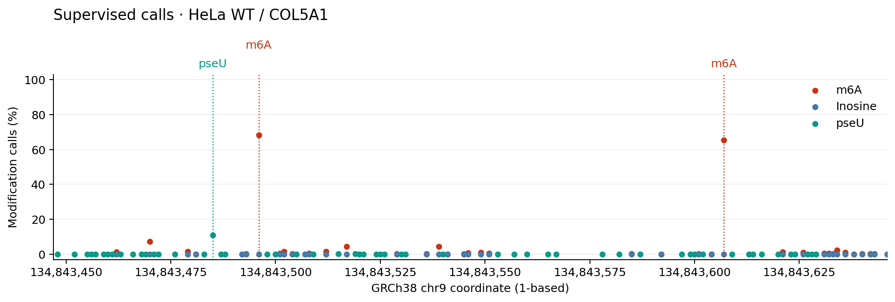
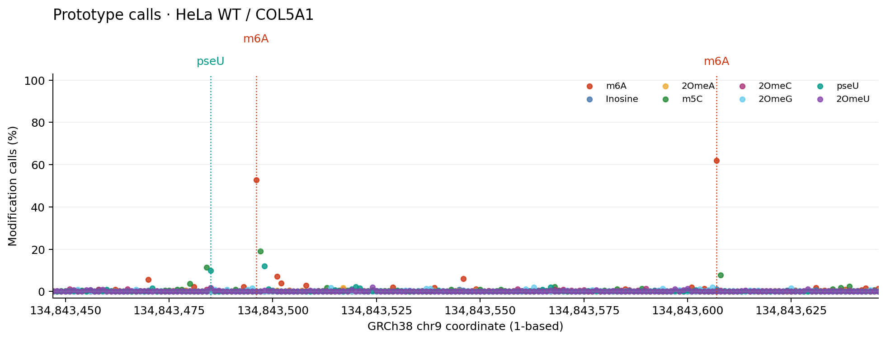
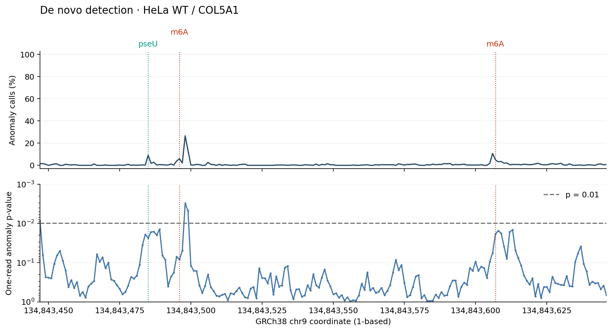
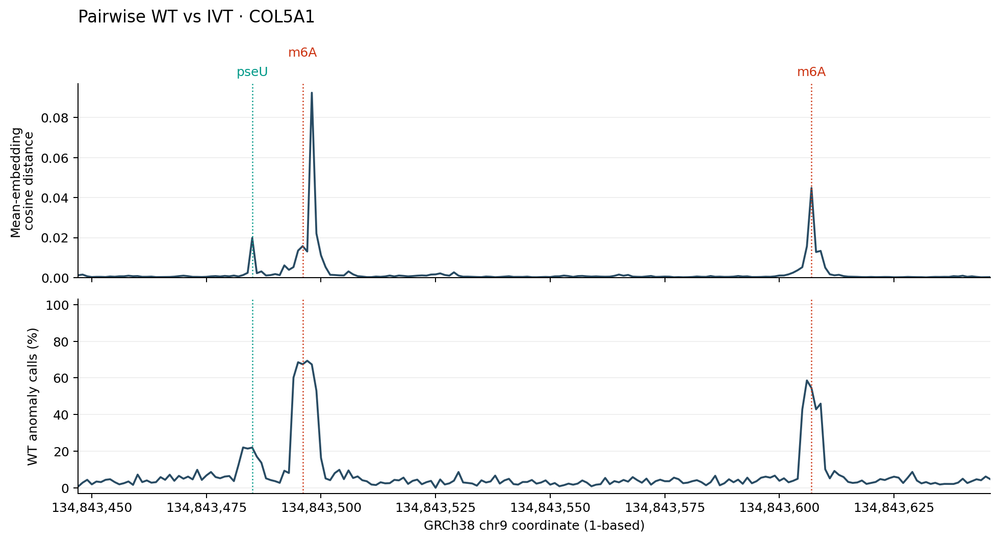

# First result: HeLa RNA

Run PoreFM on a small RNA004 dataset covering **COL5A1**: native HeLa RNA
(`WT`) and an in-vitro-transcribed control (`IVT`). This walkthrough downloads
the inputs, runs four analysis methods, and plots their outputs in the same
200-base window.

Follow [installation](getting-started/installation.md) first. The commands
below use a CUDA GPU, `curl`, `gzip`, and `samtools`. Run the Bash blocks in order in a terminal. For a first result, complete the
download and supervised sections; the remaining methods extend the comparison.
The Python plotting blocks are optional and expandable. Run them in order in
one Python session, or use the downloadable plotting script below.

## What you will need and produce

| Item | Details |
| --- | --- |
| Hardware | Linux and a CUDA GPU supported by FlashAttention 2; see [installation](getting-started/installation.md). |
| Input | A COL5A1 subset of native HeLa RNA and an IVT control, their POD5 signals, and a GRCh38 chromosome 9 reference. |
| First result | Separate BAMs and prediction Parquets from the m6A/inosine and pseU supervised models, plotted together. |
| Full walkthrough | Four plots and small site-summary tables for the same 200-base window. |
| Storage | Keep space for downloads, the decompressed FASTA, cached models, and inference outputs; pairwise comparison also creates signal BAMs. |

Model compilation makes the first run slower. Runtime and memory use depend on
the GPU, batching, and installed software. If GPU memory is limiting, use the
resource settings in the individual [analysis guides](guides/supervised.md).

## Download the example data

The files are public in [WGLab/PoreFM_examples](https://huggingface.co/datasets/WGLab/PoreFM_examples/tree/063aaa1e8ddc92705f04cd58af09fe4643869fae/hela_RNA_example).
This URL pins the dataset revision used for the figures; no Hugging Face
account or package is needed. The WT/IVT data are from:

Yongji Zou, Mian Umair Ahsan, Joe Chan, Wen Meng, Shou-Jiang Gao, Yufei Huang,
and Kai Wang. *A comparative evaluation of computational models for RNA
modification detection using nanopore sequencing with RNA004 chemistry.*
Briefings in Bioinformatics 26(4), bbaf404 (2025).
[doi:10.1093/bib/bbaf404](https://doi.org/10.1093/bib/bbaf404).

```bash
mkdir -p porefm-hela/data
cd porefm-hela

DATA_URL=https://huggingface.co/datasets/WGLab/PoreFM_examples/resolve/063aaa1e8ddc92705f04cd58af09fe4643869fae/hela_RNA_example
for file in GRCh38.chr9.fa.gz \
  HeLa_WT.COL5A1.GRCh38.bam HeLa_WT.COL5A1.GRCh38.bam.csi HeLa_WT.pod5 \
  HeLa_IVT.COL5A1.GRCh38.bam HeLa_IVT.COL5A1.GRCh38.bam.csi HeLa_IVT.pod5; do
  curl --fail --location --retry 3 "$DATA_URL/$file" --output "data/$file"
done

gzip -dc data/GRCh38.chr9.fa.gz > data/GRCh38.chr9.fa
samtools faidx data/GRCh38.chr9.fa
```

The BAMs provide basecalls and alignments; their matching POD5 files provide
the raw signal. The FASTA supplies reference coordinates. The first three
methods read BAM + POD5 directly. Pairwise comparison uses signal BAMs, which
we create below.

Models download automatically through `--model ...@v0.1.0` and are reused
from the local cache. See [Models](models.md#downloading-and-using-models) for
cache settings and offline prefetching. Use fresh output directories when
rerunning inference. The first run can take longer while models compile.

## Call m6A, inosine, and pseU with supervised models

Run two classifiers on the WT sample: one for A/m6A/inosine and one for U/pseU.
Each model has its own target base and output directory.

```bash
porefm detect-modification \
  --model WGLab/PoreFM-RNA_m6A-Inosine@v0.1.0 \
  --bam_path data/HeLa_WT.COL5A1.GRCh38.bam --pod5 data/HeLa_WT.pod5 \
  --ref data/GRCh38.chr9.fa --read_based --motif 'A 0' \
  --output_format both \
  --output outputs/supervised
```

`A 0` selects A bases in each called read. The model distinguishes canonical
A, m6A, and inosine; its checkpoint supplies chemistry settings and BAM
modification codes. `both` writes Parquets and `outputs/supervised/output.bam`
with `MM`/`ML` modification tags.

Then call pseudouridine with the pseU model:

```bash
porefm detect-modification \
  --model WGLab/PoreFM-RNA_pseU@v0.1.0 \
  --bam_path data/HeLa_WT.COL5A1.GRCh38.bam --pod5 data/HeLa_WT.pod5 \
  --ref data/GRCh38.chr9.fa --read_based --motif 'T 0' \
  --output_format both \
  --output outputs/supervised-pseu
```

`T 0` selects uridine bases, encoded as T in the BAM sequence. This model
distinguishes `U` and `pseU`; its checkpoint supplies BAM base `T` and
pseudouridine modification code `17802`. Outputs go to
`outputs/supervised-pseu`, including a separate `output.bam`.

The BAMs are unsorted because input follows POD5 traversal. Prepare copies
for a genome viewer:

```bash
samtools sort -o outputs/supervised/calls.sorted.bam outputs/supervised/output.bam
samtools index outputs/supervised/calls.sorted.bam
samtools sort -o outputs/supervised-pseu/calls.sorted.bam outputs/supervised-pseu/output.bam
samtools index outputs/supervised-pseu/calls.sorted.bam
```

### Inspect the Parquets

Keep the `checkpoint_*_data.parquet` and `checkpoint_*_meta.parquet` files
together. `open_output` joins predictions with their read identities and
coordinates for you:

```python
from porefm.outputs import open_output

supervised = open_output("outputs/supervised")
print(supervised.class_labels)  # ('A', 'm6A', 'Ino')
print(supervised.schema.names)
preview = next(supervised.iter_tables(
    columns=["readname", "chrom", "position", "predicted_class",
             "prob_m6A", "prob_Ino"],
    batch_size=5,
))
print(preview.to_pandas().to_string(index=False))

pseu = open_output("outputs/supervised-pseu")
print(pseu.class_labels)  # ('U', 'pseU')
preview = next(pseu.iter_tables(
    columns=["readname", "chrom", "position", "predicted_class", "prob_pseU"],
    batch_size=5,
))
print(preview.to_pandas().to_string(index=False))
```

## Reference annotations

PoreFM tables use **zero-based** reference positions. We select
`chr9:[134843446, 134843646)` on the forward strand (`strand=0`), and display
**one-based** positions on the plots: 134,843,447–134,843,646.

The highlighted sites are reference annotations, not targets supplied to the
models:

| Position on plot (1-based) | Modification | Reference assay | Assay percentage |
| --- | --- | --- | ---: |
| 134,843,485 | Pseudouridine (pseU) | BACS | 15.6% |
| 134,843,496 | m6A | GLORI | 71.6% |
| 134,843,607 | m6A | GLORI | 64.1% |

Reference assays:

- **GLORI (m6A):** Liu C, Sun H, Yi Y, Shen W, et al. *Absolute quantification
  of single-base m6A methylation in the mammalian transcriptome using GLORI.*
  Nat Biotechnol. 2023;41(3):355–366.
  [PMID:36302990](https://pubmed.ncbi.nlm.nih.gov/36302990/).
- **BACS (pseudouridine):** Xu H, Kong L, Cheng J, et al. *Absolute quantitative
  and base-resolution sequencing reveals comprehensive landscape of
  pseudouridine across the human transcriptome.* Nat Methods.
  2024;21(11):2024–2033.
  [doi:10.1038/s41592-024-02439-8](https://doi.org/10.1038/s41592-024-02439-8).

These assay percentages provide reference measurements. PoreFM call fractions
and anomaly fractions have different definitions and are not interchangeable
with those measurements. The three sites are also available as a
[tab-separated table](examples/hela/reference-sites.tsv).

## Reproduce the plots

[Download the plotting script](examples/hela/plot_results.py){ download="plot_results.py" }
into your `porefm-hela` directory. After both supervised runs complete, run:

```bash
python plot_results.py --method supervised
```

Use `--method prototype`, `--method zero-shot`, or `--method pairwise` after
running that method, or `--method all` after all four. The script needs no GPU.
It writes or replaces the derived files in `plots/` and `summaries/`.

To work interactively instead, expand the Python blocks below and run this
shared setup once. It adds the same site markers to every figure.

??? example "Shared Python plotting setup (run once)"

    ```python
    from pathlib import Path
    import numpy as np
    import pandas as pd
    import matplotlib.pyplot as plt
    from matplotlib.ticker import FuncFormatter

    Path("plots").mkdir(exist_ok=True)
    Path("summaries").mkdir(exist_ok=True)
    START, END = 134843446, 134843646
    region = [("chrom", "==", "chr9"), ("position", ">=", START),
              ("position", "<", END), ("strand", "==", 0)]
    truth = [(134843484, "pseU", "#009988"),
             (134843495, "m6A", "#CC3311"),
             (134843606, "m6A", "#CC3311")]

    def finish_plot(fig, axes, title, filename):
        """Label genomic tracks and save a figure using one-based display positions."""
        axes = np.atleast_1d(axes)
        for ax in axes:
            for position, label, color in truth:
                ax.axvline(position + 1, color=color, linestyle=":", linewidth=1)
            ax.set_xlim(START + 1, END)
            ax.spines[["top", "right"]].set_visible(False)
            ax.grid(axis="y", alpha=0.2)
            ax.xaxis.set_major_formatter(FuncFormatter(lambda x, _: f"{x:,.0f}"))
        for i, (position, label, color) in enumerate(truth):
            axes[0].text(position + 1, 1.04 + 0.10 * (i == 1), label,
                         transform=axes[0].get_xaxis_transform(),
                         ha="center", color=color, fontsize=10)
        axes[-1].set_xlabel("GRCh38 chr9 coordinate (1-based)")
        axes[0].set_title(title, loc="left", pad=48, fontsize=13)
        fig.tight_layout()
        fig.savefig(f"plots/{filename}.png", dpi=180, bbox_inches="tight")
        plt.show()
    ```

### Plot per-site m6A, inosine, and pseU percentages

Each summary assigns a prediction its most probable class. The m6A and inosine
percentages use all called A-family observations as their denominator; the
pseU percentage uses all called U-family observations. Canonical A and U calls
stay in their respective denominators. Keep the two summaries separate, since
the models score different bases. Retain sites with at least 20 called
observations **within each model** to avoid large percentages from a handful
of basecalling errors at other reference bases.

??? example "Python: summarize and plot supervised calls"

    ```python
    fig, ax = plt.subplots(figsize=(11, 3.8))
    runs = [
        ("supervised", [("m6A", "m6A", "#CC3311"),
                        ("Ino", "Inosine", "#4477AA")]),
        ("supervised-pseu", [("pseU", "pseU", "#009988")]),
    ]
    for directory, classes in runs:
        calls = open_output(f"outputs/{directory}")
        sites = calls.summarize_loci(
            filters=region, include_class_counts=True,
        ).sort_values("position")
        sites.to_parquet(f"summaries/{directory}.parquet", index=False)
        plot_sites = sites[sites.called_count >= 20]
        columns = ["position", "called_count"] + [f"freq_{label}" for label, _, _ in classes]
        print(directory, plot_sites[columns].head())
        for label, name, color in classes:
            ax.scatter(plot_sites.position + 1, 100 * plot_sites[f"freq_{label}"],
                       s=18, label=name, color=color)
    ax.set(ylabel="Modification calls (%)", ylim=(-3, 103))
    ax.legend(loc="upper right", frameon=False)
    finish_plot(fig, ax, "Supervised calls · HeLa WT / COL5A1", "supervised")
    ```



The two annotated m6A sites stand out among the A-family calls, while inosine
calls are low in this window. The pseU track comes from the separate U/pseU
classifier. At the annotated pseU site, it calls 33 of 301 U-family observations
as pseU (11.0%); the BACS assay reports 15.6%. These are distinct measurements,
as described above. The plot illustrates this region and does not establish
genome-wide accuracy.

## Call modifications with prototypes

The prototype model learns modification prototypes from small labelled
datasets and uses footprinting to account for neighboring effects when
calling modifications. This released RNA model supports m6A, inosine, m5C,
pseU, and 2′-O-methylated A/C/G/U, including modification types without a
released supervised classifier. Run it on the same WT BAM + POD5:

```bash
porefm prototype classify \
  --model WGLab/PoreFM-RNA_prototype@v0.1.0 \
  --bam_path data/HeLa_WT.COL5A1.GRCh38.bam --pod5 data/HeLa_WT.pod5 \
  --ref data/GRCh38.chr9.fa --read_based --motif 'N 0' \
  --effect_penalty 50 \
  --output_dir outputs/prototype
```

`N 0` scores all eligible bases. The penalty of 50 belongs to this RNA recipe;
it is not a significance threshold. Outputs are `part_*` Parquets plus
`effect_parts.json` and `effect_run.json`; keep them together.

Plot every modeled modification class in a different color. Here each class
count is divided by **all called observations at the genomic site**, including
canonical calls. This gives one common per-site denominator across classes.

??? example "Python: summarize and plot prototype calls"

    ```python
    prototype = open_output("outputs/prototype")
    print(prototype.class_labels)
    prototype_sites = prototype.summarize_loci(
        filters=region, include_class_counts=True,
    ).sort_values("position")
    prototype_sites.to_parquet("summaries/prototype.parquet", index=False)
    modifications = [label for label in prototype.class_labels
                     if label not in {"A", "C", "G", "T", "U"}]
    colors = {"m6A": "#CC3311", "Inosine": "#4477AA", "2OmeA": "#EEAA33",
              "m5C": "#228833", "2OmeC": "#AA3377", "2OmeG": "#66CCEE",
              "pseU": "#009988", "2OmeU": "#8844AA"}

    fig, ax = plt.subplots(figsize=(11, 4.3))
    for label in modifications:
        ax.scatter(prototype_sites.position + 1, 100 * prototype_sites[f"freq_{label}"],
                   s=19, alpha=0.8, color=colors[label], label=label)
    ax.set(ylabel="Modification calls (%)", ylim=(-3, 103))
    ax.legend(loc="upper right", ncol=4, frameon=False, fontsize=8)
    finish_plot(fig, ax, "Prototype calls · HeLa WT / COL5A1", "prototype")
    ```



The prototype model can assign classes across base families, including pseU.
The example shows m6A calls near both annotated m6A sites and a smaller pseU
signal near its annotation. Inspect competing calls and coverage as well as
the largest class fraction; the scores are not calibrated probabilities.

## Find anomalies with the zero-shot model

This method flags departures from canonical RNA without requiring an IVT
control or assigning a modification identity.

```bash
porefm zero-shot detect \
  --model WGLab/PoreFM-RNA_zero-shot@v0.1.0 \
  --bam_path data/HeLa_WT.COL5A1.GRCh38.bam --pod5 data/HeLa_WT.pod5 \
  --ref data/GRCh38.chr9.fa --read_based --motif 'N 0' \
  --max_pvalue 1 \
  --output_dir outputs/zero-shot
```

`--max_pvalue 1` retains both significant and nonsignificant calls so the
per-site denominator is complete. The following plot shows the percentage
of scored reads with **p ≤ 0.01**, followed by p-values along one read.
The API calls this fraction `fraction_modified`; here it is an **anomaly-call
fraction**, not a chemical identity or calibrated modification stoichiometry.

Choose a read with the most scored positions in this window (read-name order
breaks ties). This selects for coverage, without selecting on its p-values.
The p-value axis is logarithmic, with smaller values toward the top.

??? example "Python: summarize and plot zero-shot anomalies"

    ```python
    denovo = open_output("outputs/zero-shot")
    denovo_sites = denovo.summarize_loci(
        filters=region, modified_pvalue_cutoff=0.01, combine_pvalues=False,
    ).sort_values("position")
    denovo_sites.to_parquet("summaries/zero-shot.parquet", index=False)
    read_calls = pd.concat([
        table.to_pandas() for table in denovo.iter_tables(
            columns=["readname", "position", "pvalue"], filters=region,
        )
    ], ignore_index=True)
    coverage = read_calls.groupby("readname").position.nunique().rename("positions").reset_index()
    readname = coverage.sort_values(["positions", "readname"], ascending=[False, True]).iloc[0].readname
    one_read = read_calls[read_calls.readname == readname].sort_values("position")
    print("Example read:", readname, "scored positions:", len(one_read))
    one_read.to_parquet("summaries/zero-shot-read.parquet", index=False)

    fig, axes = plt.subplots(2, 1, figsize=(11, 6), sharex=True)
    axes[0].plot(denovo_sites.position + 1, 100 * denovo_sites.fraction_modified, color="#284B63")
    axes[0].set(ylabel="Anomaly calls (%)", ylim=(-3, 103))
    axes[1].plot(one_read.position + 1, one_read.pvalue.clip(lower=1e-8),
                 color="#4477AA", marker=".", markersize=3)
    axes[1].axhline(0.01, color="#777777", linestyle="--", label="p = 0.01")
    lower = min(0.001, max(1e-8, one_read.pvalue.min()))
    axes[1].set(yscale="log", ylim=(1, lower), ylabel="One-read anomaly p-value")
    axes[1].legend(frameon=False)
    finish_plot(fig, axes, "De novo detection · HeLa WT / COL5A1", "zero-shot")
    ```



Zero-shot detection highlights departures from the canonical model. The
fraction depends on the p-value threshold and can differ substantially from
supervised class fractions. Peaks may extend to neighboring bases because
nanopore signals reflect sequence context. The single read illustrates local
scores; it is not a site-level estimate.

## Compare WT with the IVT control

### Convert to signal BAMs

Pairwise comparison uses sorted BAMs containing `SG` raw-signal tags. Attach
POD5 signals to each population, then sort and index the resulting BAMs:

```bash
mkdir -p signal
for sample in WT IVT; do
  porefm utils pod5-to-bam \
    --bam "data/HeLa_${sample}.COL5A1.GRCh38.bam" \
    --input "data/HeLa_${sample}.pod5" \
    --output signal --prefix "${sample}.unsorted" --threads 4
  samtools sort -o "signal/${sample}.bam" "signal/${sample}.unsorted.bam"
  samtools index "signal/${sample}.bam"
done
```

### Run pairwise comparison

```bash
porefm pairwise-comparison \
  --model WGLab/PoreFM-RNA@v0.1.0 \
  --control-bam signal/IVT.bam --test-bam signal/WT.bam \
  --ref data/GRCh38.chr9.fa --chrom-list chr9 \
  --sitewise-embedding-shift --sitewise-anomaly-scoring \
  --output outputs/pairwise
```

The first scoring option compares mean WT and IVT embeddings. The second
scores individual WT reads against the IVT population. Sites need at least
15 retained observations in each population with the default settings.

Plot **cosine distance between mean embeddings** and the **percentage of WT
reads with p ≤ 0.01**. The latter is again an anomaly-call fraction.

??? example "Python: summarize and plot pairwise results"

    ```python
    pairwise = open_output("outputs/pairwise")
    pairwise_sites = pairwise.summarize_loci(
        filters=region, modified_pvalue_cutoff=0.01,
    ).sort_values("position")
    shifts = pd.concat([
        table.to_pandas() for table in pairwise.iter_site_tables(
            kind="locus_metrics", filters=region,
        )
    ], ignore_index=True).sort_values("position")
    pairwise_sites.to_parquet("summaries/pairwise.parquet", index=False)
    shifts.to_parquet("summaries/embedding-shifts.parquet", index=False)

    fig, axes = plt.subplots(2, 1, figsize=(11, 6), sharex=True)
    axes[0].plot(shifts.position + 1, shifts.cosine_distance, color="#284B63")
    axes[0].set(ylabel="Mean-embedding\ncosine distance", ylim=(0, None))
    axes[1].plot(pairwise_sites.position + 1, 100 * pairwise_sites.fraction_modified, color="#284B63")
    axes[1].set(ylabel="WT anomaly calls (%)", ylim=(-3, 103))
    finish_plot(fig, axes, "Pairwise WT vs IVT · COL5A1", "pairwise")
    ```



Both tracks show changes near the annotated sites, using the measured IVT
control instead of a fitted canonical reference. Nearby bases can share a
signal footprint, so the largest shift need not land exactly on the modified
base. These tracks identify differences between populations without assigning
a chemical modification identity.

## Keep the results

`plots/` contains the four figures, and `summaries/` contains the small
per-site tables used to draw them. To inspect a saved summary later:

```python
print(pd.read_parquet("summaries/supervised.parquet").head())
print(pd.read_parquet("summaries/supervised-pseu.parquet").head())
```

Each inference directory also contains `run_manifest.json`, recording model
versions, checksums, input settings, and software provenance. The figures above
use the displayed commands and the pinned dataset/model versions. For larger
analyses and additional output queries, see [processing outputs](guides/outputs.md)
and the individual [analysis guides](guides/supervised.md).
