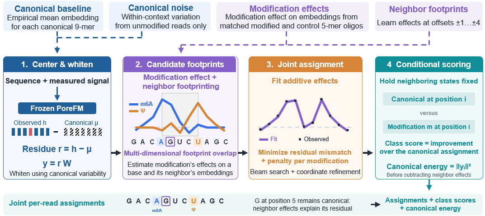

# Prototype-based joint footprinting

Call modifications using prototypes learned from small labelled datasets.
The model uses footprinting to account for neighboring modification effects
when assigning classes. The released prototype models support a broader set
of modifications than the supervised classifiers, including types without a
supervised model; see the [model catalog](../models.md).

This guide uses the released RNA model with the `residual-effects` scorer,
neighbor effects enabled, and a modification penalty of **50**.

[{ .porefm-diagram }](../git_proto.png)

The canonical baseline, noise model, and modification effects shown at the top
are already fitted in the released bundle. The command below performs scoring.

Follow [input and model preparation](inputs.md). You need `basecalls.bam`,
`pod5/`, and `reference.fa` with its `.fai`. The command downloads and caches
`WGLab/PoreFM-RNA_prototype@v0.1.0`, which contains the backbone and matching
fitted effects. No prototype extraction or fitting is needed. See
[Models](../models.md#prefetching-and-offline-use) to prefetch it for offline use.

```text
basecalls.bam + POD5 --> backbone --> observed embeddings
                                            |
fitted effects --> expected canonical baseline + modification effects
                                            |
                        residuals measured using canonical noise
                                            |
                      jointly score center and neighboring states
                              (modification penalty = 50)
                                            |
                         per-base class calls + relative scores
                                            |
                          class frequencies at reference sites
```

The effect artifact supplies the canonical baseline, noise model, supported
classes, and modification footprints. It must match the exact backbone used
when it was fitted. Neighbor scoring helps explain a perturbation across
several bases without treating every affected base as a separate event.

## Basic usage

This example scores `chr1`. Replace it with the contig names in your BAM and
reference; `--chrom` accepts more than one name.

```bash
porefm prototype classify \
  --model WGLab/PoreFM-RNA_prototype@v0.1.0 \
  --effect_penalty 50 \
  --bam_path basecalls.bam --pod5 pod5/ --ref reference.fa \
  --chrom chr1 --motif 'N 0' \
  --output_dir outputs/residual
```

`N 0` selects all eligible aligned bases. Neighbor effects and GPU scoring
are enabled by default. The penalty of 50 is part of this supplied RNA recipe;
it is not a p-value, an FDR threshold, or a universal setting for other models.
The bundle selects the residual-effects scorer. For a local bundle, replace
`--model` with `--model-path models/RNA004_prototype.pt`.

## Summarize calls within each base family

```text
outputs/residual/
|-- part_*_data.parquet       # Class calls and family-local scores
|-- part_*_meta.parquet       # Read and alignment metadata
|-- effect_parts.json        # Output parts, classes, completion state
|-- effect_run.json          # Effect model and scoring settings
|-- run_manifest.json
`-- *.pfmi                   # Automatic BAM read-ID index, if needed
```

After classification finishes:

```python
from pathlib import Path
from porefm.outputs import open_output

Path("summaries").mkdir(exist_ok=True)
calls = open_output("outputs/residual")
calls.summarize_loci(
    relative_frequencies=True,
    include_class_counts=True,
    output_path="summaries/residual.parquet",
    threads=4,
)
```

`count_LABEL` counts hard class calls. `freq_LABEL_rel` divides a class count
by all called predictions in its canonical-plus-modified family: for example,
an A modification is divided by A and all modeled A modifications. The actual
labels and families come from the artifact. A family with no calls has a null
relative frequency. `freq_LABEL` instead divides by all called classes at
the site.

Keep canonical calls in these denominators. Unsupported contexts can produce
no-calls, so inspect `called_count` alongside `total_count`. Stored effect
scores compare classes given inferred neighbors; they are **not calibrated
probabilities**.

See [processing outputs](outputs.md) for common operations and the
[effect-model reference](../prototype_effects.md) for scoring details.

## Optional settings

??? example "Expanded command with window, filtering, and resource settings"

    This Bash example reads every reference contig from the FASTA index and sets
    signal windows, read filtering, and resource limits explicitly.

    Batch size, workers, cache, block, and queue sizes control resource use.
    The effect cache alone can use up to 4096 MiB here; reduce `--effect_cache_mb`
    and `--batch_size` on smaller GPUs. Beam width and sweep count control the
    approximate search for joint class assignments.

    ```bash
    REF=reference.fa
    mapfile -t CHROMS < <(cut -f1 "${REF}.fai")

    porefm prototype classify \
      --model WGLab/PoreFM-RNA_prototype@v0.1.0 \
      --effect_neighbors on --effect_penalty 50 \
      --bam_path basecalls.bam --pod5 pod5/ --ref "$REF" \
      --chrom "${CHROMS[@]}" --motif 'N 0' \
      --size 4096 --step 3400 --num_trim 8 \
      --min_qscore 0 --min_read_length 100 \
      --batch_size 64 --reads_per_chunk 10 \
      --num_workers 4 --prefetch_factor 4 \
      --device cuda --effect_device cuda \
      --effect_cache_mb 4096 --effect_threads 4 \
      --effect_beam_width 32 --effect_max_sweeps 8 \
      --effect_block_size 4096 --effect_queue_size 8 --effect_queue_mb 512 \
      --seed 0 --log_every 100 \
      --output_dir outputs/residual
    ```
