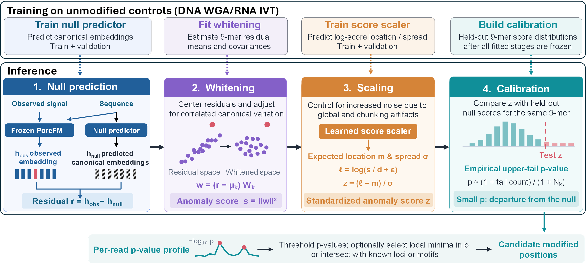

# Zero-shot detection with a canonical reference

Use this recipe to find read positions that deviate from the supplied
canonical RNA model. It uses a fitted null predictor, whitening transform,
scale model, and calibration. You do not need a control sample at inference
time or modification-labelled training data for your sample.

[{ .porefm-diagram }](../git_zero.png)

The training and fitting steps in the top row are already completed in the
released bundle. You only need to run detection on your sample.

Follow [input and model preparation](inputs.md). Supply `basecalls.bam`,
`pod5/`, and `reference.fa` with its `.fai`. The command downloads and caches
`WGLab/PoreFM-RNA_zero-shot@v0.1.0`, which contains all matching model components.
See [Models](../models.md#prefetching-and-offline-use) to prefetch it for offline use.

```text
basecalls.bam + POD5 --> backbone --> observed embedding
                                         |
sequence context --> null predictor --> expected canonical embedding
                                         |
                         observed minus expected
                                         |
                              whitening.pt
                                         |
                             residual distance
                                         |
                                scale model
                                         |
                            normalized anomaly score
                                         |
                               calibration.pt
                                         |
                              per-base p-value
                                         |
                         anomaly fraction at each site

The zero-shot bundle contains every model component shown above.
```

Whitening accounts for canonical residual variability. The scale model
accounts for context-dependent score variation; calibration converts scores
to tail p-values against the canonical reference. A small p-value indicates
a deviation, not a named modification or the probability of modification.

## Basic usage

```bash
porefm zero-shot detect \
  --bam_path basecalls.bam --pod5 pod5/ \
  --ref reference.fa --motif "N 0" \
  --model WGLab/PoreFM-RNA_zero-shot@v0.1.0 \
  --output_dir outputs/zero-shot
```

`N 0` selects all eligible aligned bases across reference contigs. Calibration
metadata in the bundle selects the score type automatically. For a local
bundle, replace `--model` with `--model-path models/RNA004_zero-shot.pt`.

## Summarize anomalies at reference sites

```text
outputs/zero-shot/
|-- part_*_data.parquet       # Position, distance, score, p-value
|-- part_*_meta.parquet       # Read and alignment metadata
|-- run_manifest.json
`-- *.pfmi                   # Automatic BAM read-ID index, if needed
```

The basic command writes calls with raw distance greater than zero. To retain
a broad range of distances for site fractions, add `--min_metric -1000` to the
detection command. Avoid restricting detection output to significant calls
or peaks: that removes calls needed for the denominator.

After detection finishes:

```python
from pathlib import Path
from porefm.outputs import open_output

Path("summaries").mkdir(exist_ok=True)
calls = open_output("outputs/zero-shot")
calls.summarize_loci(
    modified_pvalue_cutoff=0.01,
    metric_columns=["distance"],
    metric_stats=["mean"],
    output_path="summaries/zero-shot.parquet",
    threads=4,
)
```

`total_count` counts retained valid p-values at a site. `fraction_modified`
is the output API's name for the fraction with **p <= 0.01**: interpret it as
an **anomaly fraction**, not modification stoichiometry. The summary also
includes mean distance and, by default, a Fisher combined p-value. Fisher
combination assumes independent observations; it does not identify the
chemical modification responsible for a signal change.

See [processing outputs](outputs.md) for common operations and
[zero-shot reference](../canonical-null-inference.md) for specialized filtering.

## Optional settings

??? example "Expanded command with window, filtering, and resource settings"

    Use this alternative for explicit signal windows, additional loader workers,
    and broader read/call retention. `--min_qscore 0` disables the default read
    quality filter; `--min_metric -1000` retains a broad range of raw distances.
    These settings affect which calls enter downstream summaries.

    Worker count and prefetch depth control input throughput. Checkpoint and log
    intervals control output writes and progress reporting.

    ```bash
    porefm zero-shot detect \
      --bam_path basecalls.bam --pod5 pod5/ \
      --ref reference.fa --motif "N 0" \
      --model WGLab/PoreFM-RNA_zero-shot@v0.1.0 \
      --score_type auto \
      --size 4096 --step 3400 --num_trim 8 \
      --num_workers 4 --prefetch_factor 4 \
      --min_metric -1000 --min_qscore 0 \
      --checkpoint_batch_step 100 --log_every 100 \
      --output_dir outputs/zero-shot
    ```
