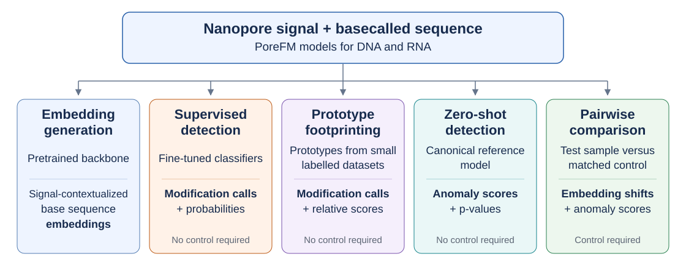

# PoreFM

**A foundation model for nanopore signal and sequence.**

PoreFM uses raw electrical signal and nucleotide sequence to detect DNA and
RNA modifications and compare samples.

[Run the RNA example](examples.md){ .md-button .md-button--primary }
[Install](getting-started/installation.md){ .md-button }
[Models](models.md){ .md-button }

## Choose an analysis

| Your goal | Method | Control sample at inference | Result |
| --- | --- | --- | --- |
| Call modifications with a fine-tuned classifier | [Supervised detection](guides/supervised.md) | No | Trained class calls and probabilities |
| Call a broader set of modifications using learned prototypes | [Prototype joint footprinting](guides/residual-prototypes.md) | No | Supported modification calls and relative scores |
| Find departures from canonical signal expectations | [Zero-shot detection](guides/zero-shot.md) | No | Anomaly scores and p-values |
| Compare a sample with a matched control | [Pairwise comparison](guides/pairwise.md) | Yes | Embedding shifts and test-read anomaly scores |

Supervised models use a classifier trained on labelled data. Prototype models
learn modification prototypes from small labelled datasets and use footprinting
to account for neighboring effects. Both use contextual PoreFM representations.
The released prototype models cover more modification types, including some
without a supervised model; see the [model catalog](models.md).

The released models include their trained components; no model training or
prototype fitting is needed to follow these inference guides. Zero-shot
detection is also called *de novo* detection: it flags departures from a
canonical model without assigning a modification identity.

Choose a release matching your sequencing chemistry: **RNA004** or
**DNA R10.4.1 (E8.2, 400 bps)**. The [model catalog](models.md) lists the
modifications supported by each classifier and prototype model.

All four methods produce read-level results that can be summarized at reference
sites. Anomaly fractions, class-call fractions, and mean probabilities measure
different quantities; see [output interpretation](guides/outputs.md#coordinates-and-denominators).

## Getting started

1. [Install PoreFM](getting-started/installation.md).
2. [Run the HeLa RNA example](examples.md) for a first result and a comparison of all four methods.
3. [Prepare your own inputs](guides/inputs.md) and follow the relevant analysis guide.
4. [Summarize and explore your results](guides/outputs.md) without loading a model.

For custom analyses, [export per-base embeddings](guides/embeddings.md).
For questions, citations, and license information, see [project information](project.md).
